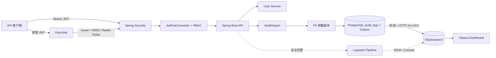
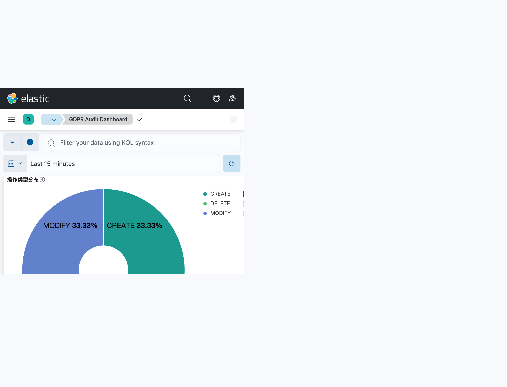

# GDPR Security Audit System

[](https://openjdk.org/)
[](https://github.com/cjjhust/CJJ_JAVA_WORKSPACE/actions/workflows/gdpr-audit-ci.yml)
[](https://spring.io/projects/spring-boot)
[](https://www.keycloak.org/)
[](https://www.postgresql.org/)
[](https://www.elastic.co/)

**Current release / 当前版本 / Aktueller Stand:** Phase 1 is complete; a local, demonstrable subset of Phase 2 is implemented and verified. This is a portfolio/demo release, not a production-grade immutable audit or legal-compliance certification. Remaining external requirements are listed below and in [`task_breakdown.md`](task_breakdown.md#milestone-20-enterprise-tamper-resistant-audit--production-hardening).

---

## 中文

### 项目定位

Java 21 / Spring Boot 3 审计服务示例：Keycloak 管理身份和 Realm 角色；Spring Security 校验 JWT 并授权；AOP 记录业务审计事件；个人信息在审计副本入库前脱敏；PostgreSQL 保存审计主记录与 Outbox，发布器确认 Elasticsearch HTTP 写入成功后标记投递完成，Kibana 提供检索和仪表盘。

### 架构



### 请求与审计流程

1. 用户通过 Keycloak 获取 JWT，Realm 角色位于 `realm_access.roles`。
2. Spring Security 校验 issuer/JWK；`JwtRoleConverter` 将 Keycloak 角色转换为 Spring `GrantedAuthority`。
3. URL 规则和方法安全注解决定是否允许业务请求。
4. `@Auditable` 触发 `AuditAspect`，抽取主体、角色、资源 ID、HTTP 状态和耗时。
5. 脱敏后的审计副本、链头更新和 Outbox 事件在同一个 PostgreSQL 事务中提交。
6. Outbox relay 直接向 Elasticsearch 写入完整事件；ES 返回 2xx 后标记 `SENT`，失败保留重试/死信状态。Kibana 用于检索和聚合；Logstash 保留给日志/告警通道，不是当前 Outbox 的投递确认端。

### 核心设计原理

本节区分通用设计思想与当前仓库的实际实现。代码里出现某种组件或模式，不等于它已经满足生产级可靠性验收。

#### 1. 身份认证与授权分离

Keycloak 是身份提供方，负责用户、Realm 角色和令牌签发；Spring Boot 是 OAuth2 Resource Server，只验证 JWT 的签名、issuer 和有效期，再把 `realm_access.roles` 映射为 Spring Security 权限。URL 规则提供粗粒度边界，`@PreAuthorize` 可在方法上加细粒度限制。这样业务服务不保存用户密码，也不自行实现认证协议。

这个边界的前提是令牌配置正确：生产环境还需校验 audience、使用 HTTPS、妥善管理 Realm 管理员和客户端凭据，并审查角色映射。开发 Realm、默认账号和 `start-dev` 不能直接用于生产。

#### 2. 声明式审计与数据最小化

业务方法用 `@Auditable` 声明“这个操作需要留痕”；`AuditAspect` 在方法执行前后收集主体、角色、资源、HTTP 上下文、结果和耗时。审计逻辑因此集中在切面中，避免每个 Controller 自己拼日志。当前成功路径是 **fail-closed**：切面在执行目标方法前开启 PostgreSQL 事务，业务数据库变更、审计链和 Outbox 一起提交；审计写入失败会向外传播并回滚同一事务，不能返回业务成功。目标方法自身失败时，业务事务回滚，切面再用独立事务尽量记录失败事件；该失败事件若也无法落库会记录严重告警，但不会把原业务错误伪装成成功。

这个保证只覆盖参与同一 PostgreSQL 事务的数据库变更。若被审计方法在事务中直接调用邮件、支付或第三方 HTTP，外部副作用不能被 PG 回滚；这类操作必须先写业务 Outbox，再由可幂等消费者执行外部动作，不能在事务里直接发送后期待数据库回滚撤销它。

切面序列化参数副本，先限制长度，再通过 `GdprDataMasker` 对常见邮箱、电话和 IBAN 模式掩码；不会修改原始请求对象。正则掩码只是降低常见 PII 暴露的措施，不是完整的个人数据识别器：姓名、地址、非标准格式、编码/拆分后的值和其他敏感字段仍可能漏过。生产方案应采用字段级 allowlist/分类、敏感字段标注、最小化采集和人工隐私评估，而非把整个请求体默认记下来。

#### 3. HMAC 哈希链：让事后改动可检测

普通日志只把事件逐行保存；哈希链则把每条记录与前一条绑定。当前实现先分配序号、写入前序哈希和密钥 ID，再对版本化规范字节计算 HMAC-SHA256：

```text
recordHash[i] = HMAC-SHA256(key, canonical-v1(event[i], sequence[i], previousHash[i], keyId[i]))
previousHash[i + 1] = recordHash[i]
```

规范编码包含格式版本、序号以及审计事件字段；字符串使用 UTF-8 和长度前缀，避免简单拼接时字段边界产生歧义。起始前序值是固定 genesis hash。每条记录的关键字段改变后，重算出的 HMAC 不再匹配；删行、调序或序号断档也会被验证器发现。

并发写入通过 `audit_chain_heads` 的悲观行锁取得唯一 `nextSequence`，然后在数据库事务中保存审计行并推进链头，避免两个并发请求拿到同一序号。验证器依序检查序号、`previousHash`、记录 HMAC 和最终链头；启动校验发现链头序号与记录最大序号不一致时进入 SAFE MODE，拒绝继续追加。

**HMAC 的能力边界：**HMAC 使用共享密钥，应用既能签名也能验证；它证明“记录与当前密钥一致”，不是公开可验证的数字签名。密钥若与应用一起泄露，攻击者可以重算链。链头也存放在同一数据库，若管理员能同时重写整库并把链头重置到较短的有效前缀，单靠本地校验无法证明被删历史曾经存在。因此还需要 KMS/HSM 非导出密钥、定期签名检查点，以及独立信任域中的 WORM 锚定。

当前只有一个 `global` 链流；多租户/多分区、密钥轮换与旧密钥验证未完成。SAFE MODE 的启动检查是序号/链头一致性检查；它不替代每次启动都完整重算哈希链，也不能替代外部锚点。

#### 4. Outbox：数据库原子入队与下游确认

Transactional Outbox 的核心思想是：业务事务中同时写入权威数据和一条待投递事件，事务提交后由独立发布器异步发送。事务回滚时两者一起消失；发布器重试时可能重复发送，因此下游必须按稳定事件 ID 幂等处理。它通常提供的是“至少一次 + 幂等消费”，而不是消息只发送一次。

本项目由 `AuditEventRecorder` 在一个事务中调用链追加和 Outbox 入队；Outbox 插入失败会抛出异常并使审计行与链头一起回滚。发布器将完整审计 envelope 直接 PUT 到 Elasticsearch，以 `auditLogId` 作为文档 ID；收到 2xx 才标记 `SENT`。消费者使用 `FOR UPDATE SKIP LOCKED` 领取 `PENDING` 事件，增加 `PROCESSING` 状态和 15 分钟租约；失败时按指数退避，达到最大次数进入 `FAILED`，管理员可请求回放。PG 集成测试覆盖并发消费者领取无重叠、租约超时接管、退避、受限账号权限以及 Outbox 插入失败时的整体回滚。

该语义是“数据库内原子入队 + 对 ES 的至少一次尝试 + 稳定 ID 幂等覆盖”，不是跨 PostgreSQL/Elasticsearch 的分布式原子事务。ES 写成功但应用在更新 `SENT` 前崩溃时会重试，同一 ID 的 PUT 覆盖同一文档。15 分钟租约覆盖当前默认 100 条批次的 HTTP 超时上界；消费者崩溃后其他实例可在租约过期后接管。失败按指数退避（上限 256 秒），达到最大次数进入 `FAILED`，可由管理员回放。

**完整性边界：**成功的 `@Auditable` 操作现在 fail-closed，PG 内业务写入、审计链和 Outbox 同事务提交；故障注入测试证明 Outbox 插入失败时业务行、审计行和链头全部回滚。仍需记住，fail-closed 会牺牲可用性：审计数据库不可用时敏感操作返回失败；客户端重试必须使用幂等键或业务幂等逻辑。它不覆盖数据库事务之外的邮件、HTTP 等外部副作用，也不抵抗同一 PG 超级用户或主机管理员。

#### 5. 追加写控制、巡检与告警

`scripts/db-hardening.sql` 将应用、迁移和 DBA 权限分开；应用角色对 `audit_logs` 只读/追加，REVOKE 和触发器拒绝改写/删除，链头触发器拒绝序号回退。它降低了日常应用账号误操作或被滥用的风险，但数据库超级用户仍能提升权限、禁用触发器或恢复数据；这不是 WORM。脚本只在一次性 PostgreSQL 环境验证过，尚未作为生产迁移应用到实际运行账号。

`AuditIntegrityMonitor` 周期检查哈希链和 Outbox 深度，Micrometer 导出链长、链头、验证结果和积压/死信指标；API 401/403 过滤器通过统一事务入口写入 PG 审计链和 Outbox。`SIEM_ALERT` 是独立 logger/appender 名称，但配置仍指向本机 Logstash/控制台，不等同于部署了独立 SIEM。`/actuator/prometheus` 受 Spring Security 认证保护，匿名访问返回 401；生产抓取需配置受限的服务身份或内部网络认证策略。

#### 6. 测试证明了什么

Testcontainers 用真实 PostgreSQL 和 Elasticsearch 测试映射、查询、索引、搜索和聚合；哈希链测试验证正常校验与篡改检测；JaCoCo 对 `GdprDataMasker` 设置了行覆盖率门槛。这些测试证明已覆盖场景的行为，不等于证明高并发吞吐、节点故障恢复、消息最终交付、管理员对抗能力、灾难恢复或法规合规。生产验收还需要故障注入、并发压测、权限负向测试、恢复演练和组织级安全/法律审查。

### 学习记录：生产化相关概念

| 概念 | 直白解释 | 本地能不能做 |
|------|----------|--------------|
| 多实例消费者租约/原子抢占 | 两个或更多 App 同时读 Outbox 时，用数据库锁或租约决定“这条消息当前由谁处理”，避免竞态、状态覆盖。 | **能。**在 Compose 跑两个 App 实例，用 PostgreSQL `FOR UPDATE SKIP LOCKED` 或租约字段实现，再用并发测试验证。 |
| Elasticsearch 中断与恢复 | ES 停机期间事件留在 Outbox；ES 恢复后重试，成功后清除积压，重复发送不产生重复文档。 | **能。**本地停启 ES、断网、制造重复投递并观察恢复结果。 |
| KMS/HSM | KMS 是 Key Management Service（密钥管理服务）；HSM 是 Hardware Security Module（硬件安全模块）。应用请求它们签名，但按权限策略不能导出私钥。 | **能做接口、轮换流程和本地模拟。**但本地软件密钥不能证明“管理员拿不到私钥”；这项属性要由实际 KMS/HSM 的权限和审计机制证明。 |
| WORM 独立归档 | Write Once, Read Many：写入后，在规定保留期内无法覆盖或删除。 | **能测流程和接口。**但同一台机器上的文件权限或对象存储容器，仍可被这台机器的管理员删除，不等于独立 WORM。 |
| 生产权限与密钥隔离 | App 只拿业务所需的最小权限；迁移、运维和密钥管理使用不同身份，秘密不放在代码或默认配置里。 | **大部分能。**本地 PostgreSQL 可验证角色权限；本地 Vault 可练习密钥注入。真实生产身份仍需在部署环境验证。 |
| SIEM | Security Information and Event Management，集中收集多个系统的安全事件，关联、告警并交给值班人员处理。 | **能搭本地演示。**例如让告警进入单独的本地安全监控服务并验证规则；但它和被监控系统共用主机时，不能证明主机失陷后告警仍独立存在。 |
| DPO/法务决策 | DPO（Data Protection Officer，数据保护官）与法务决定审计数据为何收集、保存多久、删除请求如何处理、法律保全何时适用。 | **技术流程可以本地开发，法律结论不能靠代码推导。**它需要对实际组织、数据和业务有责任的人批准。 |
| 备份恢复、RPO/RTO | RPO（Recovery Point Objective）是最多能接受丢失多少数据；RTO（Recovery Time Objective）是最多能接受多久停机。恢复演练要实测备份能否恢复及耗时。 | **能测备份脚本和本机恢复。**跨主机、跨区域灾难恢复则需要相应的独立环境才能验证。 |

### 本项目的本地生产就绪基线

不存在适用于所有行业和系统的单一“最高标准”。本项目采用一组明确、偏严格且能在本地反复验证的基线；它是作品集项目的工程验收目标，不是行业认证，也不能替真实业务组织决定风险接受程度。

| 指标 | 本项目基线 | 适用故障范围 |
|------|------------|--------------|
| 已提交审计事务 RPO | **0**：审计链记录和 Outbox 在同一个 PostgreSQL 事务提交；任一插入失败则整体回滚。只对已提交到仍可用 PG 持久卷的数据成立；当前切面 fail-open，因此不保证每次成功业务响应都一定有审计记录。 | App/ES 容器故障时已提交记录仍在 PG；不承诺 PG 持久卷、主机或磁盘整体损毁后的零丢失。 |
| Outbox 消费 | 双消费者不能重复领取未过期事件；消费者崩溃后 15 分钟租约到期可接管；ES 重复 PUT 按审计 ID 幂等。 | 同一 PostgreSQL 内的多个应用实例；不是跨主机数据库 HA。 |
| ES 单容器故障 RTO | **目标 ≤15 分钟**；PG 数据卷保留。最新完整回归中的真实 ES 容器停机/重启用例耗时 11.2 秒。App 容器自动重启尚未单独演练。 | 本机 ES 容器故障，不包含宿主机、存储设备或供电整体故障。 |
| Elasticsearch 投影追平 | **目标 ≤15 分钟处理 1,000 条积压事件**；本地 Testcontainers 实测 1,000/1,000 全部可查，用例耗时 11.2 秒；ES 不可用时事件留在 PG Outbox，恢复后自动重试。 | 指定测试负载，不外推为任意生产吞吐。 |
| 数据库权限 | 运行角色可读写业务数据、追加审计记录并推进链头；不能改写/删除审计行或回退链头。 | PostgreSQL 应用角色权限边界；超级用户和主机管理员仍可绕过本地控制。 |
| 恢复演练 | `pg_dump` 备份可恢复到独立 PostgreSQL 数据目录，恢复后核对标记记录；最新完整回归用例耗时 12.2 秒。 | 同一台开发机上的逻辑备份恢复；不是异地灾备证明。 |

这些数值是本项目的验收基线，不是宣称“业内最高”：例如金融系统可能要求跨可用区同步复制、极低 RTO、独立安全运营和正式审计认证；个人电脑单机无法证明这些目标。若目标组织要求更严，需替换基线并在目标环境重新演练。

#### 本地故障演练

在本项目 Compose 服务和端口未与其他项目冲突、`.env` 已配置的前提下，可启动第二个 App 实例（共享 PG/ES，不占宿主机 API 端口）：

```bash
APP_PORT=8082 docker compose --profile resilience up --build -d app app-secondary
docker compose ps
```

ES 容器中断/恢复演练只停止服务，不删除数据卷：

```bash
docker compose stop elasticsearch
# 在 ES 停止期间产生审计事件，确认事件留在 Outbox / 出现待处理积压
docker compose start elasticsearch
```

数据库账号已内置双账号分离，无需手工切换：`docker/postgres-init/01-create-audit-app.sql` 在数据卷首次初始化时只创建 `audit_app` 登录角色；schema 由 Flyway 用独立 DDL 账号（`FLYWAY_USER`，默认同 `POSTGRES_USER`）执行 `V1__init.sql`；表级最小权限由 `V2__grant_audit_app.sql` 在表存在之后授予。App/App-secondary 以 `audit_app` 连接（`APP_DB_USER`/`APP_DB_PASSWORD`），该账号对 `audit_logs` 只有 `SELECT, INSERT`，无 DDL。若要复用已有数据卷，删除卷重建时会重新走一遍 initdb；旧卷需手工执行一次 init 脚本与 V2 授权脚本。`scripts/db-hardening.sql` 是更严格的可选加固版本（追加写触发器、链头禁回滚触发器、DBA 维护留痕），在需要时由 DBA 账号执行。不要在未备份的个人长期数据库上直接演练权限脚本。

自动化证据（2026-11-01）：PG Testcontainers 10/10 通过，覆盖双消费者无重叠领取、租约过期接管、退避、执行实际 `scripts/db-hardening.sql` 后 `audit_app` 追加/推进链头成功、审计行改删及链头回退被拒，以及审计写失败时业务行/审计行/链头整体回滚；`SchemaPrivilegeIT` 3/3 通过，按生产顺序执行 `01-create-audit-app.sql` → `V1__init.sql` → `V2__grant_audit_app.sql`，再以 `audit_app` 验证：业务写入、审计追加、Outbox 领取与回写、链头推进全部成功；`UPDATE`/`DELETE`/`TRUNCATE audit_logs` 与 `CREATE TABLE` 均返回 `permission denied`；ES Testcontainers 2/2 通过，实际停止并重启 ES 容器，在恢复后用默认 100 条批次补投 1,000 条 backlog，索引 refresh 后核对 1,000/1,000，最新完整回归用例耗时 11.2 秒（目标 <15 分钟）；备份恢复测试通过，源 PG `pg_dump` 恢复到另一 PostgreSQL 容器和不同数据目录并核对记录，最新用例耗时 12.2 秒。这些是单机容器级故障证据，不覆盖主机/磁盘毁损；App 自动重启和长期 Compose 双实例并行尚未演练。

### DSGVO 合规流程是什么

DSGVO（欧盟《通用数据保护条例》，GDPR 的德文名称）合规不是“加上脱敏代码”或通过一组单元测试，而是组织对个人数据处理建立并持续运行的一套治理流程。系统开发者能提供技术控制和证据，但不能自行替组织决定处理是否合法，也不能凭个人项目宣称获得合规认证。

典型流程包括：

1. **明确角色与处理范围：**确认谁是数据控制者（决定处理目的和方式）、谁是处理者；盘点数据主体、数据类别、来源、接收方、处理目的和系统边界。
2. **确定目的与法律依据：**每类数据只用于明确目的，并由组织确定适用的法律依据；不能因为“系统需要审计”就默认可以无限记录或长期保留。
3. **做隐私风险评估：**识别数据泄露、越权访问、过度收集、无法履行数据主体权利等风险；高风险处理可能需要 DPIA（数据保护影响评估）。是否需要以及结论由组织/DPO 判断。
4. **落实隐私设计与安全控制：**数据最小化、字段级脱敏/假名化、最小权限、加密、访问审计、供应商和处理者管理、事件响应。正则掩码只覆盖已知格式，不等于完整识别个人数据。
5. **设置保存与处置规则：**为每类数据确定有依据的保留期限、归档、删除或限制处理方式；Legal Hold 必须有授权、范围和解除流程，不能用“审计不可变”作为无限期保存的理由。
6. **建立数据主体请求流程（DSAR）：**受理访问、更正、删除、限制处理、反对或可携带性请求；完成身份核验、审批、执行、例外判断和处理留痕。删除请求与审计证据保留冲突时，应由组织 DPO/法务决定处理依据和技术方案。
7. **准备问责证据并持续复核：**维护处理活动记录、权限审查、供应商协议、培训、事件记录和审计证据；定期检查控制是否仍有效。个人数据泄露时，组织要有评估、升级和依法通知监管机构/相关人员的流程；具体义务和时限由组织法务确认。

因此，本项目的 PII 掩码、RBAC 和审计链只是可用于合规方案的**技术控制组件**，不是完整 DSGVO 合规流程。真实组织需要结合业务目的、数据类型、合同和适用法规作出判断；本 README 不构成法律意见。

### 生产级意味着什么

“生产级”不是做完一个技术清单就自动获得的标签，也不是一项通用认证。它表示系统针对**明确的业务要求、威胁模型和运行环境**，有设计、有运维责任人，并有测试或演练证据证明达到约定目标。至少要回答：

- **保护目标和威胁主体：**要防普通用户、被盗用的应用账号、DBA，还是基础设施管理员？同一主机管理员仍能控制该主机上的容器、文件和本地秘密；若要求抵抗平台管理员，需要把密钥、锚点或告警放到他无权控制的管理域。
- **安全和可靠性目标：**身份认证、权限边界、秘密轮换、漏洞修复、容量上限、可用性、告警响应分别由谁负责，如何验证？
- **故障与恢复目标：**业务方先定义 RPO（允许丢失的最大数据窗口）和 RTO（允许的最大恢复时间），再通过备份恢复、数据库/ES 中断、消息积压和故障切换演练实测。
- **数据治理责任：**明确处理目的、法律依据、字段、保留期、访问者、DSAR 和 Legal Hold 流程，并取得组织授权。
- **证据和运营闭环：**权限负向测试、并发压测、故障注入、恢复演练、监控告警、值班和事件响应都要有结果与负责人；测试通过不等于验证了未覆盖的故障或攻击者能力。

完成这些工程步骤会显著提升生产就绪度，但不能单独推出“已认证”或“满足所有法规”。目标环境、业务要求和独立审查仍决定最终是否可投产；生产级是针对具体场景的验收结论，不是代码库自我授予的称号。

### 必须使用云服务吗

**不必须。**生产系统可以部署在企业自有数据中心、托管机房、私有云、公有云或混合环境。KMS/HSM 可以是自有硬件 HSM 或合规托管服务；不可变归档可以使用云 Object Lock，也可以使用由另一套独立管理域控制的企业归档平台。关键不是“用了云”，而是权限、管理职责和恢复副本是否真正隔离，以及能否验证。

本机可完成并证明很多工程工作：跑多个 App 实例、实现 Outbox 行锁/租约、停止 ES 后验证积压恢复、做数据库最小权限负向测试、搭本地 SIEM 接收器、备份后恢复到新卷、测本机 RPO/RTO。单机模拟适合开发和故障测试，但多个容器仍由同一个主机管理员控制，所以不能证明抵抗该管理员，也不能代表异地灾害恢复。若要求这些独立性属性，才需要不同主机、不同管理账号、独立 HSM/归档服务或组织控制的环境；云只是可选实现方式之一。

**面试回答示例：**“我不会把本地 HMAC 原型称为绝对不可篡改。当前设计能防止或检测应用账号权限范围内的常见改写，并通过集成测试验证事务回滚和 ES 投递确认。下一步我会先明确要抵御的威胁主体和 RPO/RTO，再完成多实例竞争、故障恢复、权限负向测试和恢复演练。若要求抵抗主机/平台管理员，我会把签名密钥、检查点归档或告警移到由不同权限主体控制的信任域；这可以在自建机房或云上实现，云本身不是安全保证。数据处理依据与保留期由组织 DPO/法务批准。”

### 运行演示

需要 Docker Desktop、Java 21、Maven。`.env.example` 是本地开发模板；若宿主机 `8081` 已被本地 Spring Boot 占用，可将容器映射到 `8082`：

```bash
cp .env.example .env
APP_PORT=8082 docker compose up --build -d

docker compose ps
curl http://localhost:8082/api/public/health
```

- Dashboard：<http://localhost:5601/app/dashboards#/view/gdpr-audit-dashboard>
- API health：<http://localhost:8082/api/public/health>
- Keycloak：<http://localhost:8080>
- Elasticsearch：<http://localhost:9200>



图中展示操作分布、时间线、近期审计事件等。失败操作和登录趋势在当前时间窗没有匹配数据时会显示空态；登录趋势查询 `action:LOGIN`，当前业务 API 尚未接入 Keycloak 登录事件源。

### 测试

```bash
mvn test
DOCKER_HOST=unix://$HOME/.docker/run/docker.sock mvn -Dapi.version=1.44 verify
```

完整 `verify` 包含 GDPR 脱敏、PG/ES Testcontainers、aggregation/mapping/索引验证，以及 JaCoCo `GdprDataMasker` 行覆盖率至少 90% 的质量门槛。本机 Docker Desktop 使用用户级 socket，因此命令显式提供 `DOCKER_HOST` 和 API 版本。

### 持续集成（GitHub Actions）

流水线定义在仓库根目录的 `.github/workflows/gdpr-audit-ci.yml`（本仓库是多项目仓库，因此工作流放在根目录并用 `working-directory` 指向本项目）：

- 触发条件：`gdpr-security-audit-system/**` 或该工作流文件发生变更时，在 `push`（`main`）与 `pull_request` 上运行，也支持手动 `workflow_dispatch`；
- `verify` 作业：Temurin JDK 21 + Maven 缓存，执行与本地完全一致的 `mvn -B -ntp verify`（单测 + 4 套 Testcontainers 集成测试 + JaCoCo 门槛），失败时仍上传 surefire / failsafe / JaCoCo 报告；
- `image` 作业：用 `.env.example` 生成 `.env` 后校验默认与 `resilience` 两套 compose 配置，并执行 `docker build`；
- 同一分支的新提交会取消上一次仍在运行的构建。

GitHub 的 `ubuntu-latest` runner 自带可用的 Docker，因此 Testcontainers 无需额外配置。首次远端运行结果见仓库 Actions 页面；在此之前，评分中不给 CI 计分。

### 当前安全边界

当前项目已实现 PG 内审计链+Outbox 原子入队、多实例 Outbox 租约领取，以及带 HTTP 成功确认的 ES 投递，**仍不是生产级不可篡改审计**：PG 与 ES 不是分布式原子事务；HMAC 密钥与链头未隔离到独立信任域；数据库和应用仍同处单机管理域；PG 高可用、异地主机灾备、多租户和组织级法规流程未完成。演示凭据、Keycloak `start-dev`、HTTP 和关闭 ES 安全功能仅适用于本地。生产级目标及验收标准见本节基线与 Phase 2 路线图。此说明不是 DSGVO/法律合规意见，保留期与数据主体请求需由组织 DPO/法务确认。

### 项目状态与收尾验收 — 2026-11-01

#### 项目定位

这是已完成 Phase 1 的作品集演示系统，并包含一组本地可验证的 Phase 2 防篡改与运维能力。HMAC 链能在密钥未泄露且链头可信的前提下检测审计记录变化；它不是独立签名或 WORM，不能抵抗同时控制应用密钥、数据库和运行平台的管理员。项目不声明已获得 DSGVO 法律合规认证。

#### 已实现且有验证证据

| 范围 | 实现与证据 |
|------|------------|
| Phase 1（Task 01-27） | Keycloak/OIDC、RBAC、AOP 审计、PII 掩码、PG/ELK、Kibana 九面板和 Testcontainers；历史完整验收记录见下方项目收尾快照。 |
| Task 29 哈希链 | HMAC-SHA256、确定性二进制字段编码、链头悲观锁、启动一致性检查；2026-11-01 PG 集成测试验证正常链通过，篡改后失败。 |
| Task 30/31 多实例与权限 | Outbox 通过 PostgreSQL `SKIP LOCKED` + 租约领取；Testcontainers 实测两个消费者无重复领取、过期租约接管、退避；PG 测试实际执行 `scripts/db-hardening.sql`，验证 `audit_app` 可追加、审计行改删被拒、链头不可回退。Compose 已切换为 `audit_app` 运行账号，迁移由独立 DDL 账号执行。 |
| Task 34/38 巡检基线 | 完整性巡检、SAFE MODE、Prometheus 告警规则和 Runbook 已实现；代码测试通过。 |
| Task 35 安全拒绝事件 | API 401/403 事件进入审计链并做脱敏；过滤器单测通过。 |
| Task 39/40 运维接口 | Outbox 死信查询/回放、ES `document_id` 幂等配置和审计链指标已实现。 |
| 收尾验证 | 最近一次完整 `mvn -Dapi.version=1.44 verify`：BUILD SUCCESS；PG/ES Testcontainers、JaCoCo `GdprDataMasker` 51/56 行（91.1%）通过。本文所述新的并发、权限、停启 ES 千条恢复和双卷备份测试已分别通过窄验证；之后会再跑一次完整 verify。 |

#### 已实现但仍缺端到端或外部验收

| 范围 | 尚缺的证据 |
|------|------------|
| Task 30 Outbox | 已验证原子入队回滚、SKIP LOCKED 并发领取、租约接管/退避，以及真实 ES 停止重启后 1,000 条积压约 12.4 秒追平；仍需长期运行多 App Compose 故障演练及生产级负载测量。当前实现直连 ES，不再依赖 Logstash。 |
| Task 34/39/40 运行接入 | SIEM 未连接；真实 ES 故障恢复、重复投递和回放仍需 Compose 端到端验收。`/actuator/prometheus` 受 Spring Security 保护，匿名请求实测返回 401；抓取器需配置认证。 |
| Task 35 身份事件 | 应用 API 的 401/403 现经统一事务入口写入 PG 和 Outbox；Keycloak 登录/登出、失败认证及管理面变更事件源尚未接入。 |
| Task 28/31/38 | 威胁模型待 DPO/法务签署；加固脚本在 PG Testcontainers 实际执行并通过权限负测，但尚未应用到长期运行的 Compose 数据库；PostgreSQL/宿主机故障恢复边界仍需独立演练。 |

#### 生产化范围（有意不在本地演示中虚构完成）

| 任务 | 前置条件 |
|------|----------|
| Task 32 KMS/HSM | 外部 KMS/HSM 账号、不可导出签名密钥及密钥生命周期策略。 |
| Task 33 独立 WORM | 与应用管理权限隔离的对象存储账户、锁定保留策略及法律批准的保留期。 |
| Task 36 DSGVO/DSAR | DPO/法务对删除权、保留依据、期限、Legal Hold 和 DSAR 流程作书面裁定。 |
| Task 37 生产部署 | 真实域名/TLS、CI/镜像仓库/Secret Manager、异地主机备份恢复、HA 和组织批准的 RPO/RTO 演练。单机逻辑备份恢复已测，但不等于异地灾备。 |

#### 单机能做到哪一步？（WORM 问题的分层回答）

单机**无法**实现真正意义的 WORM，但可以按成本递增逼近：

1. **本机第二份 append-only 副本**（单机可做）：签名检查点追加写入本地第二个 PostgreSQL 实例或文件（`chattr +a` append-only 属性，或独立容器挂只追加卷），校验器同时比对本库链头与副本。能发现"应用库被改"，但宿主机管理员仍可同时改两份——**只防误操作，不防管理员**。
2. **第二台机器 / 独立账户的 S3 兼容存储**（低配版 WORM）：检查点备份到另一台主机或 S3 账户，开启版本控制 + Object Lock（Governance 模式）。管理员需要攻破两个凭证域才能销毁证据。这就是 Task 33 的最小可行形态——**不强求 AWS：另一台 VPS 上的 MinIO + 定期快照也远好于没有**。
3. **合规级 WORM**：S3 Object Lock **Compliance** 模式（AWS 自己也无法提前删除）+ 独立账户。只有达到这一级，"保留期内任何人不可篡改"才在法律意义上成立。

结论：单机可落地第 1、2 层，建议至少做到第 2 层（另一台 VPS + MinIO + Object Lock Governance，月成本几欧元）；第 3 层必须依赖云厂商合规存储。

#### fail-open vs fail-closed（是什么、为什么、怎么改）

- **fail-open（当前 `AuditAspect` 行为）**：审计写入失败时只打 WARN 日志，业务照常执行。优点：审计组件故障不影响业务可用性；缺点：攻击者若能故意搞挂审计写入（锁表、塞爆 outbox），就能"无审计地"执行敏感操作。
- **fail-closed**：审计写入失败时**拒绝**该次业务操作（回滚/抛异常）。金融与强合规场景的标准选择：审计记录是法律义务，"一笔没有审计的交易"比"交易被拒绝"后果更严重。
- **推荐的生产形态（分级）**：`VIEW` 类操作 fail-open（可用性优先），`CREATE/MODIFY/DELETE/EXPORT/DOWNLOAD` 类 fail-closed（合规优先）。切换通过 `audit.chain.fail-closed` 配置项控制，而非改代码。

#### 为什么这三件事必须依赖外部？——逐项论证（2026-11-01）

**1. KMS 签名（Task 32）——为什么本地 KeyStore 不行？**

当前 HMAC 链的信任缺陷是对称性：签名与验证用同一把密钥，任何"能验签的人"同时也是"能伪造签的人"。密钥放在应用配置里，意味着持有密钥的进程/运维角色就是整条链的上帝。Java KeyStore 只是"换了个文件放密钥"，密钥依然存在应用可读的磁盘上——攻击者攻陷应用即攻陷链，防御与被防御者共享同一秘密，这不是密码学缺陷而是信任模型缺陷。

非导出密钥（KMS/HSM）从根本上改变这一点：私钥生成于云 KMS 硬件内、**在物理上无法被导出**（`kms:GetPrivateKey` 不存在，API 只提供 `Sign` 操作），应用只能请求签名、永远拿不到密钥本身。于是：
- 应用/数据库被完全攻陷 → 攻击者能签新的检查点，但**签不出与历史检查点一致且未被记录的链**；历史检查点（已锚定到 WORM）仍然不可伪造；
- 验签方（审计员/监管）只需公钥——公钥泄露无任何风险；
- 密钥策略（IAM）可以做到"应用身份只能 Sign 不能 GetPrivateKey"，权限即数学保证而非约定。

这必须依赖云，因为"非导出"是硬件安全模块（HSM）的物理属性，通用服务器软件模拟无意义。

**2. 合规级 WORM（Task 33）——为什么"另一份副本"不够？**

审计证据的价值在于**当唯一持有者说谎时仍有参照物**。任何由应用自己管理的存储（同机第二个库、同 compose 网络的 MinIO）都在同一个管理域内：宿主机管理员、root 用户、compose 网络内的人可以同时修改或删除"审计库"和"备份库"——两份一起改，对账永远是绿的。副本防的是**误操作**，防不了**有权限的说谎者**，而审计系统要防的恰恰是后者。

真正成立需要三个分离，且每个都指向外部设施：
- **凭证域分离**：归档账户与应用账户分属不同 IAM 体系，攻破应用≠能删归档 → 需要独立账户体系（云 IAM）；
- **不可覆盖性**：Object Lock Compliance 模式由 AWS 数据中心物理执行——即使 AWS 内部员工在保留期内也无法删除，这超出了任何自建系统对自身管理员的说服力 → 需要云厂商合规存储；
- **第三方对账视角**：验证方持有的检查点必须来自与应用无共同故障域的地方 → 需要另一台机器/另一朵云。

低配替代（另一台 VPS + MinIO + Governance Lock）能大幅提高攻击成本，可以作为过渡；但"保留期内任何人不可篡改"的法律声明只能由第 3 层支撑。

**3. DPO 裁定（Task 36）——为什么代码无法自我授权？**

DSGVO 下审计记录（IP、username、操作历史）就是 personal data。这里存在一个**法律冲突而非技术冲突**：用户有删除权（Art. 17），而审计系统存在的意义是"记录不可变"。这个冲突的解法——审计日志是否适用 Art. 17(3)(b) 的豁免、保留多久合法（90 天还是 GoBD 要求的更长）、tombstone 式删除（留摘要删明细）算不算"删除"、legal hold 谁有权触发——**每一个都是法律判断**，其正确性取决于行业、数据类别、诉讼场景，不存在"从代码推导出合法"的路径。

如果工程师自行实现一套删除逻辑，最坏情况是：系统诚实地执行了"删除"，但 DSGVO 监管机构认定该删除方式不合法（比如摘要仍可识别个人），或者反过来——删除了本应按 GoBD 保留 10 年的记账凭证审计。**写代码的人承担不了这个责任，必须由法定角色（DPO/Datenschutzbeauftragter）书面裁定并签字**，这正是为什么 Task 36 的技术底座可以预开发、而流程上线必须等签字。

#### 剩余可做清单（按优先级，本地可完成）

> 2026-11-01 更新：以下 6 项中第 1-5 项已全部实现并通过验证；仅第 6 项的*加强版*（另一台机器）仍属外部条件。

1. ~~fail-closed 分级开关~~ ✅ 已实现：`audit.chain.fail-closed`（默认 `true`），写操作审计失败回滚、VIEW 类放行；`AuditAspectFailClosedTest` 4/4 通过
2. ~~`/api/audit/logs` 接真数据~~ ✅ 已实现：查真实 `audit_logs` 表，倒序分页、null 安全、limit 上限 200，mock 已删除
3. ~~全局异常处理器~~ ✅ 已实现：`GlobalExceptionHandler` 统一 `{timestamp,status,error,message,path}` 格式；SAFE MODE 映射 503 不泄露内部状态
4. ~~Flyway 迁移~~ ✅ 已实现：`db/migration/V1__init.sql`（5 张表 + 索引 + 种子数据），`ddl-auto: validate`，`sql.init` 关闭
5. ~~Compose 切受限账号~~ ✅ 已实现：`docker/postgres-init/01-create-audit-app.sql` 随数据卷首次初始化仅创建 `audit_app` 角色（此时表尚不存在，故不做表级授权）；表级授权改由迁移 `V2__grant_audit_app.sql` 在 V1 建表后授予，并由 `ALTER DEFAULT PRIVILEGES` 覆盖后续新表。Flyway 以 `FLYWAY_USER`（`audit_user`）执行 DDL，App 以 `audit_app` 运行，两者权限分离。
6. 本机第二份 append-only 副本 ✅ 已实现（`AuditChainReplicaService`：30s 追加检查点、60s 与链头比对、不一致触发 SIEM 告警；检查点按 `(序号, 哈希)` 去重防重复追加，校验采用全量重放而非只看末行；单测 8/8 含回滚/哈希篡改/副本内序号回退/重复检查点检出）；跨机器副本仍待外部条件

#### 第三方评估总结（2026-11-01）

以下为本项目收尾时基于全量源码评审的客观评估，评分维度与扣分理由均已对齐可验证证据。

**总体评分：89 / 100**（2026-11-01 复核，上一版 82 分）—— 剩余的 11 分仍然全部对应"本地无法自证的外部条件"或"需要组织/法务签字"的事项。

| 评估维度 | 得分 | 与上一版对比 | 评审依据 |
|----------|------|--------------|----------|
| 功能完整性 | 18/20 | +2 | 审计全链路、防篡改、Outbox、运维接口齐全；本轮补上 `/api/audit/logs` 真实查询与失败分级；Keycloak 管理事件（Task 35 剩余）与 DSAR 删除流程仍缺 |
| 代码质量 | 18/20 | +1 | 修掉 fail-open 返回 `null` 的语义 bug、删除死分支、列长度对齐 schema、副本服务改全量重放；仍有 AOP 隐式事务、无统一分页规范等小瑕疵 |
| 测试工程 | 18/20 | +1 | 65 项测试全绿（49 单测 + 4 套 Testcontainers），新增 `SchemaPrivilegeIT` 把"initdb 建角色 → V1 建表 → V2 授权"链路固化为回归；强制覆盖率仍只覆盖 `GdprDataMasker` |
| 架构与文档 | 15/15 | 0 | 三语文档、威胁模型、Runbook、阻塞分析完整，且如实标注能力边界 |
| 生产就绪 | 12/15 | +3 | Flyway + DDL/DML 双账号分离、fail-closed 分级、Outbox 租约消费、本机 append-only 副本与 RPO/RTO 基线均已落地；CI 流水线已配置（`.github/workflows/gdpr-audit-ci.yml`，与本地同款 `mvn verify` + 镜像构建），首次远端运行通过前不计分；KMS/HSM 签名、合规级 WORM、TLS、PG 高可用仍需外部设施 |
| 合规闭环 | 8/10 | 0 | PII 脱敏与数据最小化文档完整；保留期限与删除权冲突待 DPO/法务书面裁定 |

**本轮提分的关键三点（都可复现）：**

1. **权限链路从"纸面"变成"可验证"**：原 `docker/postgres-init` 在建表前 `GRANT` 会静默失败，`audit_app` 实际无表权限、也无 `CREATE` 供 Flyway 建历史表——也就是说"受限账号"从来没真正跑起来过。现在改成"init 只建角色 → V1 建表 → V2 授权"，并用 `SchemaPrivilegeIT` 以 `SET ROLE audit_app` 断言：业务写入/审计追加/Outbox 回写/链头推进成功，`UPDATE`/`DELETE`/`TRUNCATE audit_logs` 与 `CREATE TABLE` 被 `permission denied` 拒绝。
2. **fail-open 不再吞返回值**：审计写失败且按策略放行时返回业务真实结果，而不是 `null`；对应单测此前断言 `isNull()`，等于把 bug 固化成了预期，已一并纠正。
3. **证据链可重跑**：`mvn -B -Dapi.version=1.44 verify` exit 0，65 项测试全绿（含 ES 停启 1,000 条补投 20.02 秒、PG 备份恢复 11.73 秒），JaCoCo 门槛通过。

**评估结论：**该项目可以正式收尾。技术能力描述可进入简历，但按诚实披露原则，KMS/HSM 签名、外部 WORM 锚定、Keycloak 管理事件接入、PG 高可用与生产合规验证应列明为"生产化阶段工作"而非已完成能力。文档三件套（readme / task_breakdown / TODO.MD）状态一致。

#### 项目定位与能力边界（第三方复核，2026-11-01）

**本项目在同类作品集中的位置。** 常见的学生或转行作品集是"Spring Boot CRUD + JWT + 若干张表 + 接口截图"；本项目把范围收窄到"审计证据链"这一件事，并在该范围内做到可以追问到底：

- **完整性**：HMAC-SHA256 哈希链 + 链头悲观锁 + 启动一致性校验 + SAFE MODE 熔断，篡改可被检出，而不只是"记了日志"；
- **一致性**：审计与业务写入共享同一个 PostgreSQL 事务，失败时业务行、审计行、链头整体回滚（fail-closed 分级），而不是"先写业务再补日志"；
- **并发**：Outbox 采用 `FOR UPDATE SKIP LOCKED` + 租约 + 指数退避，多实例消费不重复；
- **最小权限**：DDL / DML 双账号分离，运行账号对 `audit_logs` 只有 `SELECT, INSERT`，并由集成测试证明 `UPDATE` / `DELETE` / `TRUNCATE` / `CREATE TABLE` 被数据库拒绝；
- **证据**：65 项测试（49 单测 + 4 套 Testcontainers 集成测试）、JaCoCo 行覆盖率门槛、ES 停机补投与 PG 备份恢复的实测耗时；
- **文档**：威胁模型、事件响应 Runbook、RPO/RTO 基线与能力边界声明齐备。

**本项目仍有不足。**

- 单服务、单机：演示栈跑在本机 Docker Compose 上，没有 Kubernetes、没有云上部署、没有真实流量与压力测试；
- CI 目前只覆盖"构建 + 测试 + 镜像构建"，尚无多环境发布、镜像扫描与制品签名；
- 故障演练规模有限（2 个消费者 + 1,000 条 backlog），证明机制正确，不证明性能；
- 呈现层依赖 Kibana，没有产品化前端；
- Keycloak 管理事件接入、DSAR 删除流程、保留期限策略尚未闭环，其中删除权与审计留存的法律冲突必须由 DPO 书面裁定，代码不能自我授权；
- 代码量约 3,900 行（主代码 ~2,500 / 测试 ~1,400），属于"小体积深项目"，不等同于大型系统经验。

**本项目可以作为：**

- 可以作为 Java / Spring Boot 后端岗位的求职作品集——它提供的是"能讲清分布式一致性、权限边界与合规约束"的可追问素材，而不是功能清单；
- 可以作为不可变审计/证据链方向的技术演示与本地实验平台：篡改注入、ES 中断恢复、备份恢复、权限边界均可复现；
- 可以作为简历中的具体条目，但须写明验证层级为"本地可运行 + 容器级故障验证"。

**本项目不能作为：**

- 不能作为生产就绪（production-ready）系统：缺 KMS/HSM 密钥托管、外部 WORM 锚定、TLS 与网络隔离、高可用与异地灾备；
- 不能作为 GDPR 合规认证或法律意义上的审计留痕证明：合规结论需要组织、DPO 与法务签字；
- 不能据此宣称具备大规模分布式系统的运维经验。

**作品集收尾结论：**本仓库可作为本地可运行、测试全绿的安全审计演示项目收尾；简历可描述已实现的技术能力，但须将 KMS/HSM、外部 WORM、Keycloak 管理事件和生产合规验证列为未完成/生产化工作。任务级状态与已知限制以 [`task_breakdown.md`](task_breakdown.md) 为准。


---

## English

### Project scope

A Java 21 / Spring Boot 3 audit-service portfolio system. Keycloak manages identities and realm roles; Spring Security validates JWTs and authorizes requests; an AOP aspect records business events; PII is masked in the audit copy before persistence. PostgreSQL atomically stores the audit chain and Outbox; multiple app instances claim Outbox work with PostgreSQL row locking and lease expiry, then write to Elasticsearch using an idempotent document ID. Kibana provides search and dashboards.

### Request flow

1. The client obtains a JWT from Keycloak; realm roles are in `realm_access.roles`.
2. Spring Security validates issuer/JWK; `JwtRoleConverter` maps Keycloak roles to Spring `GrantedAuthority` values.
3. URL rules and method-security annotations authorize the API operation.
4. `@Auditable` invokes `AuditAspect` to capture principal, roles, resource ID, HTTP result, and duration.
5. The masked audit copy, chain head, and Outbox event commit in one PostgreSQL transaction.
6. Outbox consumers claim work with `FOR UPDATE SKIP LOCKED`; Elasticsearch 2xx confirms delivery, stable event IDs make retries idempotent, and Kibana provides search and aggregation.

### Run the demo

Requirements: Docker Desktop, Java 21, Maven. Copy `.env.example` for local development. Use port `8082` if a host application already occupies `8081`:

```bash
cp .env.example .env
APP_PORT=8082 docker compose up --build -d

docker compose ps
curl http://localhost:8082/api/public/health
```

- Dashboard: <http://localhost:5601/app/dashboards#/view/gdpr-audit-dashboard>
- API health: <http://localhost:8082/api/public/health>


The dashboard contains operation distribution, timeline, recent events, top users, failed operations, high-risk events, client-IP activity, and a login-event IP trend. Empty results are expected when no matching event exists in the selected time window. The login panel queries `action:LOGIN`; a Keycloak login-event source is not yet connected to this demo API.

Run tests:

```bash
mvn test
DOCKER_HOST=unix://$HOME/.docker/run/docker.sock mvn -Dapi.version=1.44 verify
```

The full verification covers PII masking, PostgreSQL/Elasticsearch-Testcontainers, indexes/mappings/aggregations, and a JaCoCo line-coverage gate of at least 90% for `GdprDataMasker`.

### Security boundary

The project atomically writes the audit chain and Outbox within PostgreSQL, supports multiple Outbox consumers with leases, and marks ES projection complete only after HTTP success. It is still **not production-certified or immutable against platform administrators**: PostgreSQL and Elasticsearch are not one distributed transaction; HMAC keys and chain heads are not isolated in an independent trust domain; the Compose runtime has not been switched to its restricted DB role; host-loss disaster recovery and legal governance remain incomplete. Demo credentials, Keycloak `start-dev`, HTTP, and disabled Elasticsearch security are local-development settings only. Retention and data-subject handling require review by the organization's DPO/legal team; this repository is not legal advice.

---

## Deutsch

### Projektumfang

Ein Audit-Service-Portfolio-Projekt mit Java 21 und Spring Boot 3. Keycloak verwaltet Identitäten und Realm-Rollen; Spring Security prüft JWTs und autorisiert Anfragen; ein AOP-Aspect protokolliert Geschäftsereignisse. Personenbezogene Daten werden in der Audit-Kopie vor der Speicherung maskiert. PostgreSQL speichert Audit-Kette und Outbox atomar; mehrere App-Instanzen übernehmen Outbox-Ereignisse mit Zeilensperren und Lease-Ablauf und schreiben idempotent nach Elasticsearch. Kibana dient Suche und Dashboard.

### Ablauf einer Anfrage

1. Der Client erhält ein JWT von Keycloak; Realm-Rollen stehen in `realm_access.roles`.
2. Spring Security prüft Issuer/JWK; `JwtRoleConverter` bildet Keycloak-Rollen auf Spring `GrantedAuthority` ab.
3. URL-Regeln und Method-Security autorisieren den API-Aufruf.
4. `@Auditable` aktiviert `AuditAspect`, der Identität, Rollen, Ressourcen-ID, HTTP-Ergebnis und Dauer erfasst.
5. Die maskierte Audit-Kopie, der Kettenkopf und das Outbox-Ereignis werden gemeinsam in einer PostgreSQL-Transaktion gespeichert.
6. Outbox-Consumer übernehmen Ereignisse mit `FOR UPDATE SKIP LOCKED`; erst eine erfolgreiche Elasticsearch-HTTP-Antwort bestätigt die Zustellung. Stabile Ereignis-IDs machen Wiederholungen idempotent.

### Demo starten

Voraussetzungen: Docker Desktop, Java 21 und Maven. `.env.example` ist für die lokale Entwicklung vorgesehen. Falls Port `8081` bereits belegt ist, Port `8082` verwenden:

```bash
cp .env.example .env
APP_PORT=8082 docker compose up --build -d

docker compose ps
curl http://localhost:8082/api/public/health
```

- Dashboard: <http://localhost:5601/app/dashboards#/view/gdpr-audit-dashboard>
- API-Health: <http://localhost:8082/api/public/health>


Das Dashboard zeigt Operationsverteilung, Zeitverlauf, aktuelle Ereignisse, Top-Benutzer, fehlgeschlagene und risikoreiche Vorgänge sowie IP-Aktivität. Ohne passende Ereignisse im Zeitfenster ist ein leerer Zustand erwartbar. Der Login-Trend filtert `action:LOGIN`; eine Quelle für Keycloak-Loginereignisse ist noch nicht mit der Demo-API verbunden.

Tests ausführen:

```bash
mvn test
DOCKER_HOST=unix://$HOME/.docker/run/docker.sock mvn -Dapi.version=1.44 verify
```

Die vollständige Prüfung umfasst PII-Maskierung, PostgreSQL/Elasticsearch-Testcontainers, Indizes/Mappings/Aggregationen und eine JaCoCo-Zeilenabdeckung von mindestens 90 % für `GdprDataMasker`.

### Sicherheitsgrenzen

Das Projekt schreibt Audit-Kette und Outbox atomar innerhalb von PostgreSQL, unterstützt mehrere Outbox-Consumer mit Lease und markiert die Zustellung erst nach einer erfolgreichen Elasticsearch-HTTP-Antwort. Es ist weiterhin **keine produktionszertifizierte oder gegen Plattformadministratoren manipulationssichere Audit-Plattform**: PostgreSQL und Elasticsearch bilden keine gemeinsame verteilte Transaktion; HMAC-Schlüssel und Kettenkopf sind nicht in einer unabhängigen Vertrauensdomäne isoliert; die Compose-Laufzeit verwendet noch nicht die eingeschränkte DB-Rolle; PostgreSQL-HA, standortübergreifende Wiederherstellung und rechtliche Abläufe sind unvollständig. Demo-Zugangsdaten, Keycloak `start-dev`, HTTP und deaktivierte Elasticsearch-Sicherheit sind ausschließlich für die lokale Entwicklung vorgesehen. Aufbewahrungsfristen und Betroffenenrechte müssen durch DPO/Rechtsabteilung geprüft werden; dieses Projekt ist keine Rechtsberatung.

---

## Debug Journal / Debug-Protokoll / 调试记录

| 观察 / Observation / Beobachtung | 原因 / Cause / Ursache | 解决 / Resolution / Lösung |
|---|---|---|
| `debugjava: command not found`，exit 127 | VS Code 启动辅助工具调用了 shell 中不存在的命令；Maven/源码不是根因。 / The editor helper invoked a missing shell command. / Das Start-Hilfsprogramm rief einen nicht vorhandenen Shell-Befehl auf. | 用 `mvn spring-boot:run` 或 VS Code Java Launch 配置启动，不要在项目中伪造 `debugjava` 命令。 / Start through Maven or a Java launch configuration. / Über Maven oder eine Java-Launch-Konfiguration starten. |
| Logstash 旧容器停在 `Created`，原对象后来消失 | 旧容器日志不可取回，无法证实最初触发原因；当前 pipeline 配置有效。 / The stale container's original failure log was unavailable. / Das ursprüngliche Fehlerprotokoll des veralteten Containers war nicht mehr verfügbar. | 只重建 Logstash：`docker compose up -d logstash`；检查 `main` pipeline 和 TCP 50000 listener，不删除数据卷。 / Recreate only Logstash and inspect its pipeline/listener. / Nur Logstash neu erstellen und Pipeline/Listener prüfen. |
| Testcontainers 找不到 Docker 或收到 HTTP 400 | Docker Desktop 使用用户级 socket，默认 API 协商不兼容。 / Docker Desktop uses a user socket and newer API negotiation. / Docker Desktop verwendet einen benutzerspezifischen Socket und eine neuere API-Aushandlung. | `DOCKER_HOST=unix://$HOME/.docker/run/docker.sock mvn -Dapi.version=1.44 verify`。/ Set the Docker host and API version. / Docker-Host und API-Version explizit setzen. |
| ES 写入出现 `503 unavailable_shards_exception` | HTTP endpoint 已启动，但测试索引主分片尚未 active。 / The endpoint was ready before the index primary shard. / Der HTTP-Endpunkt war bereit, bevor der primäre Index-Shard aktiv war. | 测试等待索引 health 至少 yellow 后再写；最终在 Testcontainers ES 容器内执行 curl，避免随机宿主端口映射干扰。/ Wait for yellow health and execute requests inside the container. / Auf Yellow-Status warten und Anfragen im Container ausführen. |
| JaCoCo 显示 0 classes analyzed | `includes` glob 未匹配目标类，造成规则空通过。 / The include pattern matched no class. / Das Include-Muster fand keine Klasse. | 使用 `**/GdprDataMasker*`；确认日志显示 1 class analyzed，并检查 `target/site/jacoco/jacoco.xml`。/ Match the class and verify the analyzed count. / Klassenmuster korrigieren und Anzahl geprüfter Klassen kontrollieren. |
| Kibana XY 图表报 axis `text` undefined | Saved Object 缺少 category/value axis title。/ Axis title fields were missing. / Achsentitel fehlten im Saved Object. | 为两个轴补 `title.text`，重新导入对象并在浏览器检查页面错误。/ Add both axis titles, reimport, and inspect browser errors. / Beide Achsentitel ergänzen, erneut importieren und Browserfehler prüfen. |
