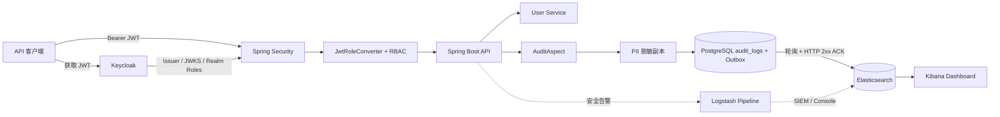

# GDPR Security Audit System

[](https://openjdk.org/)
[](https://spring.io/projects/spring-boot)
[](https://www.keycloak.org/)
[](https://www.postgresql.org/)
[](https://www.elastic.co/)

**Current release / 当前版本 / Aktueller Stand:** Phase 1 is complete; a local, demonstrable subset of Phase 2 is implemented and verified. This is a portfolio/demo release, not a production-grade immutable audit or legal-compliance certification. Remaining external requirements are listed below and in [`task_breakdown.md`](task_breakdown.md#milestone-20-enterprise-tamper-resistant-audit--production-hardening).

---

## 中文

### 项目定位

Java 21 / Spring Boot 3 审计服务示例：Keycloak 管理身份和 Realm 角色；Spring Security 校验 JWT 并授权；AOP 记录业务审计事件；个人信息在审计副本入库前脱敏；PostgreSQL 保存审计主记录，Logback 异步将结构化事件送到 Logstash/Elasticsearch，Kibana 提供检索和仪表盘。

### 架构



### 请求与审计流程

1. 用户通过 Keycloak 获取 JWT，Realm 角色位于 `realm_access.roles`。
2. Spring Security 校验 issuer/JWK；`JwtRoleConverter` 将 Keycloak 角色转换为 Spring `GrantedAuthority`。
3. URL 规则和方法安全注解决定是否允许业务请求。
4. `@Auditable` 触发 `AuditAspect`，抽取主体、角色、资源 ID、HTTP 状态和耗时。
5. 脱敏后的审计副本、链头更新和 Outbox 事件在同一个 PostgreSQL 事务中提交。
6. Outbox relay 直接向 Elasticsearch 写入完整事件；ES 返回 2xx 后标记 `SENT`，失败保留重试/死信状态。Kibana 用于检索和聚合；Logstash 保留给日志/告警通道，不是当前 Outbox 的投递确认端。

### 核心设计原理

本节区分通用设计思想与当前仓库的实际实现。代码里出现某种组件或模式，不等于它已经满足生产级可靠性验收。

#### 1. 身份认证与授权分离

Keycloak 是身份提供方，负责用户、Realm 角色和令牌签发；Spring Boot 是 OAuth2 Resource Server，只验证 JWT 的签名、issuer 和有效期，再把 `realm_access.roles` 映射为 Spring Security 权限。URL 规则提供粗粒度边界，`@PreAuthorize` 可在方法上加细粒度限制。这样业务服务不保存用户密码，也不自行实现认证协议。

这个边界的前提是令牌配置正确：生产环境还需校验 audience、使用 HTTPS、妥善管理 Realm 管理员和客户端凭据，并审查角色映射。开发 Realm、默认账号和 `start-dev` 不能直接用于生产。

#### 2. 声明式审计与数据最小化

业务方法用 `@Auditable` 声明“这个操作需要留痕”；`AuditAspect` 在方法执行前后收集主体、角色、资源、HTTP 上下文、结果和耗时。审计逻辑因此集中在切面中，避免每个 Controller 自己拼日志。审计异常当前按演示模式 fail-open 处理：写审计失败会告警，但不改变已经执行的业务结果。

切面序列化参数副本，先限制长度，再通过 `GdprDataMasker` 对常见邮箱、电话和 IBAN 模式掩码；不会修改原始请求对象。正则掩码只是降低常见 PII 暴露的措施，不是完整的个人数据识别器：姓名、地址、非标准格式、编码/拆分后的值和其他敏感字段仍可能漏过。生产方案应采用字段级 allowlist/分类、敏感字段标注、最小化采集和人工隐私评估，而非把整个请求体默认记下来。

#### 3. HMAC 哈希链：让事后改动可检测

普通日志只把事件逐行保存；哈希链则把每条记录与前一条绑定。当前实现先分配序号、写入前序哈希和密钥 ID，再对版本化规范字节计算 HMAC-SHA256：

```text
recordHash[i] = HMAC-SHA256(key, canonical-v1(event[i], sequence[i], previousHash[i], keyId[i]))
previousHash[i + 1] = recordHash[i]
```

规范编码包含格式版本、序号以及审计事件字段；字符串使用 UTF-8 和长度前缀，避免简单拼接时字段边界产生歧义。起始前序值是固定 genesis hash。每条记录的关键字段改变后，重算出的 HMAC 不再匹配；删行、调序或序号断档也会被验证器发现。

并发写入通过 `audit_chain_heads` 的悲观行锁取得唯一 `nextSequence`，然后在数据库事务中保存审计行并推进链头，避免两个并发请求拿到同一序号。验证器依序检查序号、`previousHash`、记录 HMAC 和最终链头；启动校验发现链头序号与记录最大序号不一致时进入 SAFE MODE，拒绝继续追加。

**HMAC 的能力边界：**HMAC 使用共享密钥，应用既能签名也能验证；它证明“记录与当前密钥一致”，不是公开可验证的数字签名。密钥若与应用一起泄露，攻击者可以重算链。链头也存放在同一数据库，若管理员能同时重写整库并把链头重置到较短的有效前缀，单靠本地校验无法证明被删历史曾经存在。因此还需要 KMS/HSM 非导出密钥、定期签名检查点，以及独立信任域中的 WORM 锚定。

当前只有一个 `global` 链流；多租户/多分区、密钥轮换与旧密钥验证未完成。SAFE MODE 的启动检查是序号/链头一致性检查；它不替代每次启动都完整重算哈希链，也不能替代外部锚点。

#### 4. Outbox：数据库原子入队与下游确认

Transactional Outbox 的核心思想是：业务事务中同时写入权威数据和一条待投递事件，事务提交后由独立发布器异步发送。事务回滚时两者一起消失；发布器重试时可能重复发送，因此下游必须按稳定事件 ID 幂等处理。它通常提供的是“至少一次 + 幂等消费”，而不是消息只发送一次。

本项目由 `AuditEventRecorder` 在一个事务中调用链追加和 Outbox 入队；Outbox 插入失败会抛出异常并使审计行与链头一起回滚。发布器将完整审计 envelope 直接 PUT 到 Elasticsearch，以 `auditLogId` 作为文档 ID；收到 2xx 才标记 `SENT`，网络错误或非 2xx 会递增重试次数并最终进入 `FAILED`，管理员可请求回放。PG 集成测试覆盖同事务落库以及 Outbox 插入失败时的整体回滚；发布器测试覆盖 ES 2xx 和 503→死信。

该语义是“数据库内原子入队 + 对 ES 的至少一次尝试 + 稳定 ID 幂等覆盖”，不是跨 PostgreSQL/Elasticsearch 的分布式原子事务。ES 写成功但应用在更新 `SENT` 前崩溃时会重试，同一 ID 的 PUT 覆盖同一文档。当前 publisher 假设单个应用实例轮询；多实例需加入行级抢占/租约或消息中间件，避免并发重复消费。生产部署还应通过真实 ES 故障注入、认证 TLS、重试退避/熔断、积压 SLO 和恢复演练验证。

#### 5. 追加写控制、巡检与告警

`scripts/db-hardening.sql` 将应用、迁移和 DBA 权限分开；应用角色对 `audit_logs` 只读/追加，REVOKE 和触发器拒绝改写/删除，链头触发器拒绝序号回退。它降低了日常应用账号误操作或被滥用的风险，但数据库超级用户仍能提升权限、禁用触发器或恢复数据；这不是 WORM。脚本只在一次性 PostgreSQL 环境验证过，尚未作为生产迁移应用到实际运行账号。

`AuditIntegrityMonitor` 周期检查哈希链和 Outbox 深度，Micrometer 导出链长、链头、验证结果和积压/死信指标；API 401/403 过滤器将拒绝事件写入 PG 审计链。当前拒绝事件路径没有同步写 Outbox，也没有显式发送到 ES。`SIEM_ALERT` 是独立 logger/appender 名称，但配置仍指向本机 Logstash/控制台，不等同于部署了独立 SIEM。`/actuator/prometheus` 受 Spring Security 认证保护，匿名访问返回 401；生产抓取需配置受限的服务身份或内部网络认证策略。

#### 6. 测试证明了什么

Testcontainers 用真实 PostgreSQL 和 Elasticsearch 测试映射、查询、索引、搜索和聚合；哈希链测试验证正常校验与篡改检测；JaCoCo 对 `GdprDataMasker` 设置了行覆盖率门槛。这些测试证明已覆盖场景的行为，不等于证明高并发吞吐、节点故障恢复、消息最终交付、管理员对抗能力、灾难恢复或法规合规。生产验收还需要故障注入、并发压测、权限负向测试、恢复演练和组织级安全/法律审查。

### 运行演示

需要 Docker Desktop、Java 21、Maven。`.env.example` 是本地开发模板；若宿主机 `8081` 已被本地 Spring Boot 占用，可将容器映射到 `8082`：

```bash
cp .env.example .env
APP_PORT=8082 docker compose up --build -d

docker compose ps
curl http://localhost:8082/api/public/health
```

- Dashboard：<http://localhost:5601/app/dashboards#/view/gdpr-audit-dashboard>
- API health：<http://localhost:8082/api/public/health>
- Keycloak：<http://localhost:8080>
- Elasticsearch：<http://localhost:9200>


图中展示操作分布、时间线、近期审计事件等。失败操作和登录趋势在当前时间窗没有匹配数据时会显示空态；登录趋势查询 `action:LOGIN`，当前业务 API 尚未接入 Keycloak 登录事件源。

### 测试

```bash
mvn test
DOCKER_HOST=unix://$HOME/.docker/run/docker.sock mvn -Dapi.version=1.44 verify
```

完整 `verify` 包含 GDPR 脱敏、PG/ES Testcontainers、aggregation/mapping/索引验证，以及 JaCoCo `GdprDataMasker` 行覆盖率至少 90% 的质量门槛。本机 Docker Desktop 使用用户级 socket，因此命令显式提供 `DOCKER_HOST` 和 API 版本。

### 当前安全边界

当前项目虽已实现 PG 内审计链+Outbox 原子入队，以及带 HTTP 成功确认的 ES 投递，**仍不是生产级不可篡改审计**：PG 与 ES 不是分布式原子事务；HMAC 密钥与链头未隔离到独立信任域；管理员仍可能绕过本地权限；单实例、多租户、灾备和法规流程未完成。演示凭据、Keycloak `start-dev`、HTTP 和关闭 ES 安全功能仅适用于本地。生产级目标及验收标准见 Phase 2 路线图。此说明不是 DSGVO/法律合规意见，保留期与数据主体请求需由组织 DPO/法务确认。

### 项目状态与收尾验收 — 2026-11-01

#### 项目定位

这是已完成 Phase 1 的作品集演示系统，并包含一组本地可验证的 Phase 2 防篡改与运维能力。HMAC 链能在密钥未泄露且链头可信的前提下检测审计记录变化；它不是独立签名或 WORM，不能抵抗同时控制应用密钥、数据库和运行平台的管理员。项目不声明已获得 DSGVO 法律合规认证。

#### 已实现且有验证证据

| 范围 | 实现与证据 |
|------|------------|
| Phase 1（Task 01-27） | Keycloak/OIDC、RBAC、AOP 审计、PII 掩码、PG/ELK、Kibana 九面板和 Testcontainers；历史完整验收记录见下方项目收尾快照。 |
| Task 29 哈希链 | HMAC-SHA256、确定性二进制字段编码、链头悲观锁、启动一致性检查；2026-11-01 PG 集成测试验证正常链通过，篡改后失败。 |
| Task 31 数据库加固 | `scripts/db-hardening.sql`；在一次性 PostgreSQL 16 容器实测脚本安装成功，`audit_app` 可追加记录并推进链头，更新/删除审计行被拒，链头回退被触发器拒绝。该测试未改动 Compose 使用的数据库。 |
| Task 34/38 巡检基线 | 完整性巡检、SAFE MODE、Prometheus 告警规则和 Runbook 已实现；代码测试通过。 |
| Task 35 安全拒绝事件 | API 401/403 事件进入审计链并做脱敏；过滤器单测通过。 |
| Task 39/40 运维接口 | Outbox 死信查询/回放、ES `document_id` 幂等配置和审计链指标已实现。 |
| 收尾验证 | 2026-11-01 完整 `mvn -Dapi.version=1.44 verify`：BUILD SUCCESS；JaCoCo 检查 `GdprDataMasker` 51/56 行（91.1%）通过。`docker compose config --quiet` 通过；当前演示栈健康端点返回 `UP`。 |

#### 已实现但仍缺端到端或外部验收

| 范围 | 尚缺的证据 |
|------|------------|
| Task 30 Outbox | 已验证 DB 原子入队回滚、发布器对 ES 2xx/503 的处理；仍需多实例并发抢占、真实 ES 重启/网络分区、积压恢复和重放端到端演练。当前实现直连 ES，不再依赖 Logstash；如保留 Logstash 管道，需明确其用途并验证不会造成双路重复写。 |
| Task 34/39/40 运行接入 | SIEM 未连接；真实 ES 故障恢复、重复投递和回放仍需 Compose 端到端验收。`/actuator/prometheus` 受 Spring Security 保护，匿名请求实测返回 401；抓取器需配置认证。 |
| Task 35 身份事件 | 应用 API 的 401/403 现经统一事务入口写入 PG 和 Outbox；Keycloak 登录/登出、失败认证及管理面变更事件源尚未接入。 |
| Task 28/31/38 | 威胁模型待 DPO/法务签署；加固脚本已在隔离 PG 验证，但尚未应用到长期运行的 Compose 数据库；重启/崩溃故障注入未完成。 |

#### 生产化范围（有意不在本地演示中虚构完成）

| 任务 | 前置条件 |
|------|----------|
| Task 32 KMS/HSM | 外部 KMS/HSM 账号、不可导出签名密钥及密钥生命周期策略。 |
| Task 33 独立 WORM | 与应用管理权限隔离的对象存储账户、锁定保留策略及法律批准的保留期。 |
| Task 36 DSGVO/DSAR | DPO/法务对删除权、保留依据、期限、Legal Hold 和 DSAR 流程作书面裁定。 |
| Task 37 生产部署 | 真实域名/TLS、CI/镜像仓库/Secret Manager、备份恢复目标及 RPO/RTO 演练环境。 |

**作品集收尾结论：**本仓库可作为本地可运行、测试通过的安全审计演示项目收尾；简历可描述已实现的技术能力，但须将 KMS/HSM、外部 WORM、Keycloak 管理事件和生产合规验证列为未完成/生产化工作。任务级状态与已知限制以 [`task_breakdown.md`](task_breakdown.md) 为准。


---

## English

### Project scope

A Java 21 / Spring Boot 3 audit-service demo. Keycloak manages identities and realm roles; Spring Security validates JWTs and authorizes requests; an AOP aspect records business events; PII is masked in the audit copy before persistence. PostgreSQL stores the primary audit record, while Logback asynchronously sends structured events through Logstash to Elasticsearch for Kibana search and dashboards.

### Request flow

1. The client obtains a JWT from Keycloak; realm roles are in `realm_access.roles`.
2. Spring Security validates issuer/JWK; `JwtRoleConverter` maps Keycloak roles to Spring `GrantedAuthority` values.
3. URL rules and method-security annotations authorize the API operation.
4. `@Auditable` invokes `AuditAspect` to capture principal, roles, resource ID, HTTP result, and duration.
5. The masked audit copy is stored in PostgreSQL; structured AUDIT JSON is queued asynchronously.
6. Logstash derives `severity` and `environment`, writes to Elasticsearch, and Kibana provides search and aggregation.

### Run the demo

Requirements: Docker Desktop, Java 21, Maven. Copy `.env.example` for local development. Use port `8082` if a host application already occupies `8081`:

```bash
cp .env.example .env
APP_PORT=8082 docker compose up --build -d

docker compose ps
curl http://localhost:8082/api/public/health
```

- Dashboard: <http://localhost:5601/app/dashboards#/view/gdpr-audit-dashboard>
- API health: <http://localhost:8082/api/public/health>


The dashboard contains operation distribution, timeline, recent events, top users, failed operations, high-risk events, client-IP activity, and a login-event IP trend. Empty results are expected when no matching event exists in the selected time window. The login panel queries `action:LOGIN`; a Keycloak login-event source is not yet connected to this demo API.

Run tests:

```bash
mvn test
DOCKER_HOST=unix://$HOME/.docker/run/docker.sock mvn -Dapi.version=1.44 verify
```

The full verification covers PII masking, PostgreSQL/Elasticsearch Testcontainers, indexes/mappings/aggregations, and a JaCoCo line-coverage gate of at least 90% for `GdprDataMasker`.

### Security boundary

The project now atomically writes the audit chain and Outbox within PostgreSQL and marks delivery only after an Elasticsearch HTTP success response. It is still **not production-grade immutable auditing**: PostgreSQL and Elasticsearch are not one distributed transaction; HMAC keys and chain heads are not isolated in an independent trust domain; privileged administrators can bypass local controls; multi-instance coordination, disaster recovery, and legal workflows remain incomplete. Demo credentials, Keycloak `start-dev`, HTTP, and disabled Elasticsearch security are local-development settings only. Retention and data-subject handling require review by the organization's DPO/legal team; this repository is not legal advice.

---

## Deutsch

### Projektumfang

Ein Audit-Service-Demo mit Java 21 und Spring Boot 3. Keycloak verwaltet Identitäten und Realm-Rollen; Spring Security prüft JWTs und autorisiert Anfragen; ein AOP-Aspect protokolliert Geschäftsereignisse. Personenbezogene Daten werden in der Audit-Kopie vor der Speicherung maskiert. PostgreSQL speichert den primären Audit-Datensatz; strukturierte Ereignisse werden asynchron über Logstash an Elasticsearch für Suche und Kibana-Dashboards gesendet.

### Ablauf einer Anfrage

1. Der Client erhält ein JWT von Keycloak; Realm-Rollen stehen in `realm_access.roles`.
2. Spring Security prüft Issuer/JWK; `JwtRoleConverter` bildet Keycloak-Rollen auf Spring `GrantedAuthority` ab.
3. URL-Regeln und Method-Security autorisieren den API-Aufruf.
4. `@Auditable` aktiviert `AuditAspect`, der Identität, Rollen, Ressourcen-ID, HTTP-Ergebnis und Dauer erfasst.
5. Die maskierte Audit-Kopie wird in PostgreSQL gespeichert; strukturiertes AUDIT-JSON wird asynchron eingereiht.
6. Logstash ergänzt `severity` und `environment`, schreibt nach Elasticsearch; Kibana ermöglicht Suche und Aggregation.

### Demo starten

Voraussetzungen: Docker Desktop, Java 21 und Maven. `.env.example` ist für die lokale Entwicklung vorgesehen. Falls Port `8081` bereits belegt ist, Port `8082` verwenden:

```bash
cp .env.example .env
APP_PORT=8082 docker compose up --build -d

docker compose ps
curl http://localhost:8082/api/public/health
```

- Dashboard: <http://localhost:5601/app/dashboards#/view/gdpr-audit-dashboard>
- API-Health: <http://localhost:8082/api/public/health>


Das Dashboard zeigt Operationsverteilung, Zeitverlauf, aktuelle Ereignisse, Top-Benutzer, fehlgeschlagene und risikoreiche Vorgänge sowie IP-Aktivität. Ohne passende Ereignisse im Zeitfenster ist ein leerer Zustand erwartbar. Der Login-Trend filtert `action:LOGIN`; eine Quelle für Keycloak-Loginereignisse ist noch nicht mit der Demo-API verbunden.

Tests ausführen:

```bash
mvn test
DOCKER_HOST=unix://$HOME/.docker/run/docker.sock mvn -Dapi.version=1.44 verify
```

Die vollständige Prüfung umfasst PII-Maskierung, PostgreSQL/Elasticsearch-Testcontainers, Indizes/Mappings/Aggregationen und eine JaCoCo-Zeilenabdeckung von mindestens 90 % für `GdprDataMasker`.

### Sicherheitsgrenzen

Das Projekt schreibt Audit-Kette und Outbox inzwischen atomar innerhalb von PostgreSQL und markiert die Zustellung erst nach einer erfolgreichen Elasticsearch-HTTP-Antwort. Es ist weiterhin **keine produktionsreife manipulationssichere Audit-Plattform**: PostgreSQL und Elasticsearch bilden keine gemeinsame verteilte Transaktion; HMAC-Schlüssel und Kettenkopf sind nicht in einer unabhängigen Vertrauensdomäne isoliert; privilegierte Administratoren können lokale Kontrollen umgehen; Mehrinstanzbetrieb, Disaster Recovery und rechtliche Abläufe sind unvollständig. Demo-Zugangsdaten, Keycloak `start-dev`, HTTP und deaktivierte Elasticsearch-Sicherheit sind ausschließlich für die lokale Entwicklung vorgesehen. Aufbewahrungsfristen und Betroffenenrechte müssen durch DPO/Rechtsabteilung geprüft werden; dieses Projekt ist keine Rechtsberatung.

---

## Debug Journal / Debug-Protokoll / 调试记录

| 观察 / Observation / Beobachtung | 原因 / Cause / Ursache | 解决 / Resolution / Lösung |
|---|---|---|
| `debugjava: command not found`，exit 127 | VS Code 启动辅助工具调用了 shell 中不存在的命令；Maven/源码不是根因。 / The editor helper invoked a missing shell command. / Das Start-Hilfsprogramm rief einen nicht vorhandenen Shell-Befehl auf. | 用 `mvn spring-boot:run` 或 VS Code Java Launch 配置启动，不要在项目中伪造 `debugjava` 命令。 / Start through Maven or a Java launch configuration. / Über Maven oder eine Java-Launch-Konfiguration starten. |
| Logstash 旧容器停在 `Created`，原对象后来消失 | 旧容器日志不可取回，无法证实最初触发原因；当前 pipeline 配置有效。 / The stale container's original failure log was unavailable. / Das ursprüngliche Fehlerprotokoll des veralteten Containers war nicht mehr verfügbar. | 只重建 Logstash：`docker compose up -d logstash`；检查 `main` pipeline 和 TCP 50000 listener，不删除数据卷。 / Recreate only Logstash and inspect its pipeline/listener. / Nur Logstash neu erstellen und Pipeline/Listener prüfen. |
| Testcontainers 找不到 Docker 或收到 HTTP 400 | Docker Desktop 使用用户级 socket，默认 API 协商不兼容。 / Docker Desktop uses a user socket and newer API negotiation. / Docker Desktop verwendet einen benutzerspezifischen Socket und eine neuere API-Aushandlung. | `DOCKER_HOST=unix://$HOME/.docker/run/docker.sock mvn -Dapi.version=1.44 verify`。/ Set the Docker host and API version. / Docker-Host und API-Version explizit setzen. |
| ES 写入出现 `503 unavailable_shards_exception` | HTTP endpoint 已启动，但测试索引主分片尚未 active。 / The endpoint was ready before the index primary shard. / Der HTTP-Endpunkt war bereit, bevor der primäre Index-Shard aktiv war. | 测试等待索引 health 至少 yellow 后再写；最终在 Testcontainers ES 容器内执行 curl，避免随机宿主端口映射干扰。/ Wait for yellow health and execute requests inside the container. / Auf Yellow-Status warten und Anfragen im Container ausführen. |
| JaCoCo 显示 0 classes analyzed | `includes` glob 未匹配目标类，造成规则空通过。 / The include pattern matched no class. / Das Include-Muster fand keine Klasse. | 使用 `**/GdprDataMasker*`；确认日志显示 1 class analyzed，并检查 `target/site/jacoco/jacoco.xml`。/ Match the class and verify the analyzed count. / Klassenmuster korrigieren und Anzahl geprüfter Klassen kontrollieren. |
| Kibana XY 图表报 axis `text` undefined | Saved Object 缺少 category/value axis title。/ Axis title fields were missing. / Achsentitel fehlten im Saved Object. | 为两个轴补 `title.text`，重新导入对象并在浏览器检查页面错误。/ Add both axis titles, reimport, and inspect browser errors. / Beide Achsentitel ergänzen, erneut importieren und Browserfehler prüfen. |
